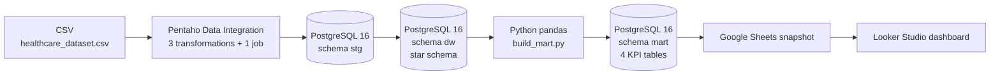
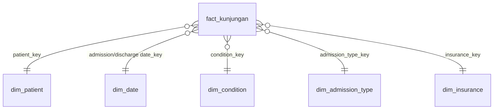

# Hospital Data Mini-Platform: From Source Data to KPI Dashboard

An end-to-end data engineering and BI prototype: raw CSV → staging → star-schema data warehouse → KPI data mart → interactive dashboard.
Built as a university group project (Data Engineering, S1 Information Systems, UPN Veteran Jakarta).

**Live dashboard:** https://datastudio.google.com/reporting/1e04f2d2-1527-4adc-93f4-0ef93bd0f93a/page/tuTAG

> **Data note:** The dataset is the public [Healthcare Dataset on Kaggle](https://www.kaggle.com/datasets/prasad22/healthcare-dataset) (CC0), **synthetic**, generated with Faker. Wait time is synthetically generated per admission type, and the bed capacity (600) is an assumption. Dashboard numbers demonstrate that the pipeline is consistent end to end; they do **not** describe a real hospital.

## Business problem

Hospital data is spread across systems and reported manually in Excel, which is slow and error-prone. Management needs a single, clean source of truth to monitor **visits, bed occupancy, wait time, and revenue**.

## Architecture



The database runs in Docker, so the environment is easy to recreate.

### Star schema (`dw`)



1 fact table (`fact_kunjungan`, one row per admission) and 5 dimensions: date, patient, condition, admission type, insurance.

## Data quality

| Stage | Change | Rows left |
|---|---|---|
| Loaded to staging | none | 55,500 |
| Remove duplicates (Unique rows) | -534 | 54,966 |
| Remove negative billing (Filter rows) | -106 | 54,860 |
| Loaded to `fact_kunjungan` | none | 54,860 |

Raw data stays untouched in `stg.healthcare_raw`, so removed rows remain traceable. Dimension loads use a NOT EXISTS pattern so the job can be re-run without duplicate keys.
`dim_patient` has no medical record number in the source, so a natural key (Title-Cased name + age + gender + blood type) is used, giving 54,944 unique patients.

## KPIs and reconciliation

Dashboard values were checked against direct SQL queries on PostgreSQL:

| KPI | PostgreSQL | Dashboard |
|---|---|---|
| Total visits | 54,860 | 54,860 |
| Total revenue | Rp1,404,121,599.97 | Rp1,404,121,599.97 |
| Avg. bed occupancy (assumes 600 beds) | 77.58% | 77.58 |
| Avg. wait time (synthetic, minutes) | 60.06 | 60.06 |

KPI tables in `mart`: `kpi_kunjungan_bulanan`, `kpi_pendapatan_bulanan`, `kpi_waktu_tunggu`, `kpi_okupansi_harian`.


## Notable problems solved

- **Pentaho step order:** all steps inside one transformation run in parallel, so dimensions could not be guaranteed to load before the fact table. Split into three transformations run sequentially by one job.
- **Locale bug in Google Sheets:** with Indonesian locale, decimals like `22.9` were parsed as dates, skewing average wait time (53.72 instead of 60.06). Fixed by storing total minutes (integer) in the mart and computing `SUM(total_menit_tunggu) / SUM(jumlah_kunjungan)` in Looker Studio.
- **Looker Studio cross-filtering** emptied other charts after one click; disabled it in chart interaction settings.
- **Duplicate key** in `dim_date` on re-run; fixed with the NOT EXISTS load pattern.

## Tech stack

Pentaho Data Integration CE 9.4 (Spoon) · PostgreSQL 16 · Docker · Python 3.13 (pandas, SQLAlchemy) · Looker Studio · Google Sheets

## How to run

```powershell
# 1. Start PostgreSQL
Copy-Item .env.example .env        # then edit POSTGRES_PASSWORD
docker compose up -d

# 2. Create schemas and tables
docker cp sql/schema.sql hospital-pg:/tmp/schema.sql
docker exec hospital-pg psql -U postgres -d hospital_dw -f /tmp/schema.sql

# 3. Download healthcare_dataset.csv into data/raw/ (see data/raw/README.md)

# 4. In Pentaho Spoon, open pentaho/00_main.kjb and run it
#    (connection: localhost:5433, db hospital_dw; point the CSV step to data/raw/healthcare_dataset.csv)

# 5. Build the KPI data mart
py -m venv .venv
.\.venv\Scripts\Activate.ps1
pip install -r requirements.txt
$env:POSTGRES_PASSWORD = "your_password"
python python/build_mart.py
```

`build_mart.py` also exports the four KPI tables to `docs/looker/*.csv`, which were uploaded to Google Sheets as the Looker Studio data source.

## Limitations

- Only 1 of the 4 designed sources (CSV) is implemented; SIMRS database, Excel unit files and lab API are design-only.
- Pipeline runs manually (no scheduler); dashboard is a Google Sheets snapshot, not a live connection.
- Patient identity masking was designed but not applied (data is already synthetic).
- No doctor/clinic dimension: `doctor` and `hospital` are almost entirely unique values in this dataset.

## My contribution

> TODO: describe your part in 2–3 lines (e.g. which components you built).

## Team

> TODO: add teammates' GitHub profiles (with their permission).
