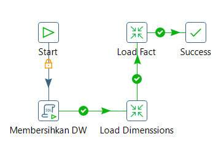
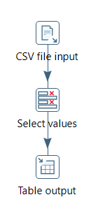
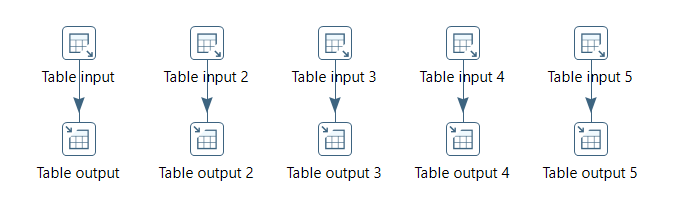
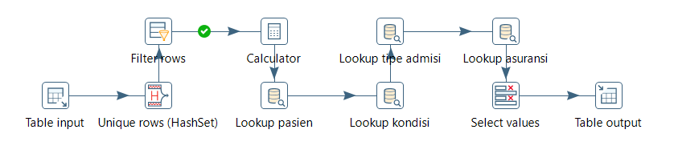
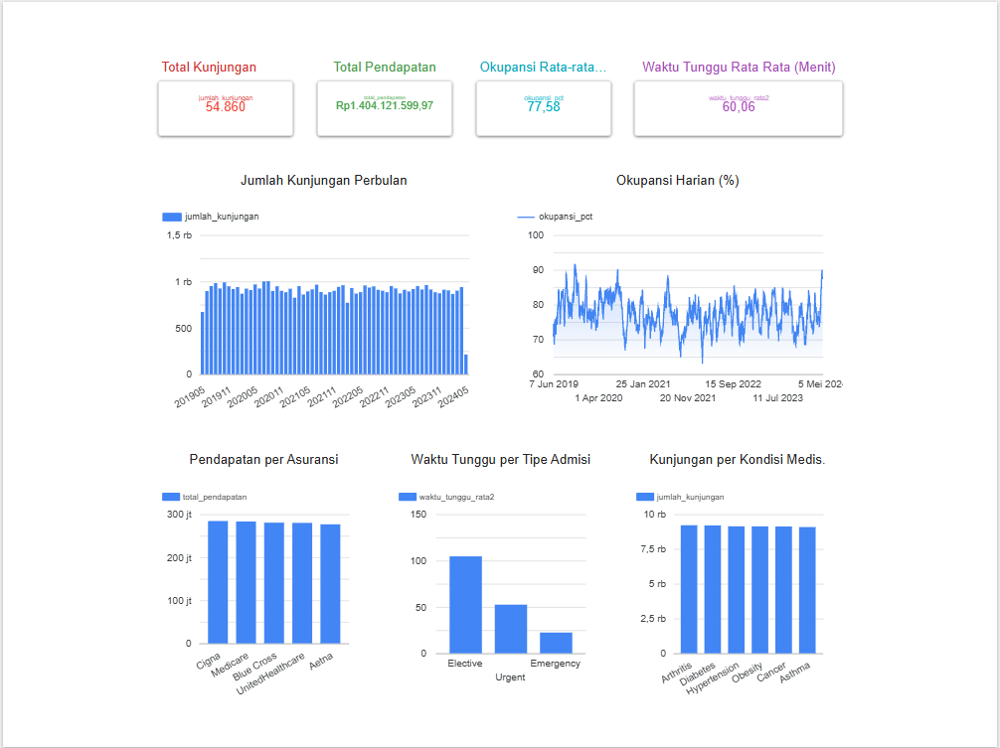

# Hospital Data Pipeline

End-to-end ETL pipeline that transforms raw hospital admission records into a dimensional data warehouse and KPI data marts for operational analytics.

---

## Architecture

```
CSV (raw)
  └─► stg.healthcare_raw          Staging — load as-is
        └─► dw.dim_*              Dimensions (date, patient, condition,
            dw.fact_kunjungan       admission type, insurance)
              └─► mart.kpi_*      Aggregated KPI tables
```

**Stack:** PostgreSQL 16 · Pentaho PDI · Python (pandas, SQLAlchemy) · Docker · Looker Studio

---

## ETL Flow

The pipeline is orchestrated by a single PDI job (`00_main.kjb`) that runs three transformations in sequence.

### `00_main.kjb`


### `01_load_staging.ktr` — Raw load
Reads `healthcare_dataset.csv` and loads all 55,500 rows into `stg.healthcare_raw` without any transformation. Preserves dirty data for auditability.



### `02_load_dimensions.ktr` — Dimension population
Populates five dimension tables from staging using Lookup + Insert/Update steps (SCD Type 1).



### `03_load_fact.ktr` — Fact load
Joins all dimension keys, filters out negative billing rows (rejected to `docs/rejected_billing_negatif.csv`), computes `length_of_stay`, and inserts into `fact_kunjungan`.



---

## Schema

```sql
-- Dimensions
dw.dim_date            (date_key, full_date, year, quarter, month, ...)
dw.dim_patient         (patient_key, name, age, gender, blood_type)
dw.dim_condition       (condition_key, medical_condition)
dw.dim_admission_type  (admission_type_key, admission_type)
dw.dim_insurance       (insurance_key, insurance_provider)

-- Fact
dw.fact_kunjungan      (admission_id, patient_key, admission_date_key,
                         discharge_date_key, condition_key, admission_type_key,
                         insurance_key, length_of_stay, wait_minutes, billing_amount, ...)

-- Mart (built by etl/build_mart.py)
mart.kpi_kunjungan_bulanan    -- visits by month / type / condition
mart.kpi_pendapatan_bulanan   -- revenue by month / insurance provider
mart.kpi_waktu_tunggu         -- wait time aggregates by month / type
mart.kpi_okupansi_harian      -- daily bed occupancy
```

---

## Data Summary

| Layer | Table | Rows |
|---|---|---|
| Staging | `stg.healthcare_raw` | 55,500 |
| DW | `dw.fact_kunjungan` | 54,860 |
| DW | `dw.dim_patient` | 54,944 |
| DW | `dw.dim_date` | 1,888 |
| DW | `dw.dim_condition` | 6 |
| DW | `dw.dim_admission_type` | 3 |
| DW | `dw.dim_insurance` | 5 |
| Mart | `kpi_kunjungan_bulanan` | 1,098 |
| Mart | `kpi_pendapatan_bulanan` | 305 |
| Mart | `kpi_waktu_tunggu` | 183 |
| Mart | `kpi_okupansi_harian` | 1,797 |

**Period:** May 2019 – Aug 2024  
**Rejected:** 108 rows (negative billing amount)  
**Total billing:** $1,404,121,599.97  
**Avg bed occupancy:** 77.58% (assumed capacity: 600 beds)

---

## Dashboard

> Live: [Looker Studio](https://lookerstudio.google.com/LINK-DASHBOARD-LO-DI-SINI)



---

## Running Locally

**Prerequisites:** Docker Desktop, Python 3.10+, Pentaho Spoon 9.x

```bash
# 1. Start database
docker compose up -d

# 2. Init schema
docker exec -i hospital-pg psql -U postgres -d hospital_dw < etl/schema.sql

# 3. Run ETL — open 00_main.kjb in Pentaho Spoon and execute

# 4. Build KPI mart
pip install -r requirements.txt
python etl/build_mart.py
```

Database: `localhost:5433` · user `postgres` · password `postgres123` · db `hospital_dw`

---

## Notes

- `wait_minutes` is synthetically generated (source data has no wait time field)
- Bed capacity (600) is assumed; the dataset does not include capacity data
- Occupancy is computed as cumulative daily census: Σ admissions − Σ discharges

---

## Author

Yanuar Arifin — Data Engineering, Semester 5
